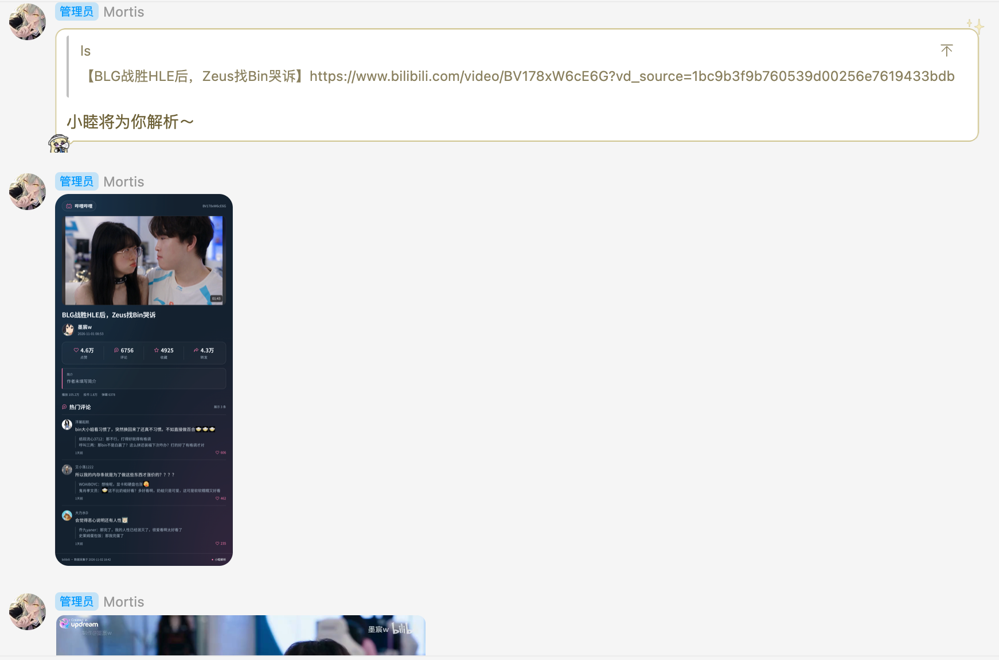
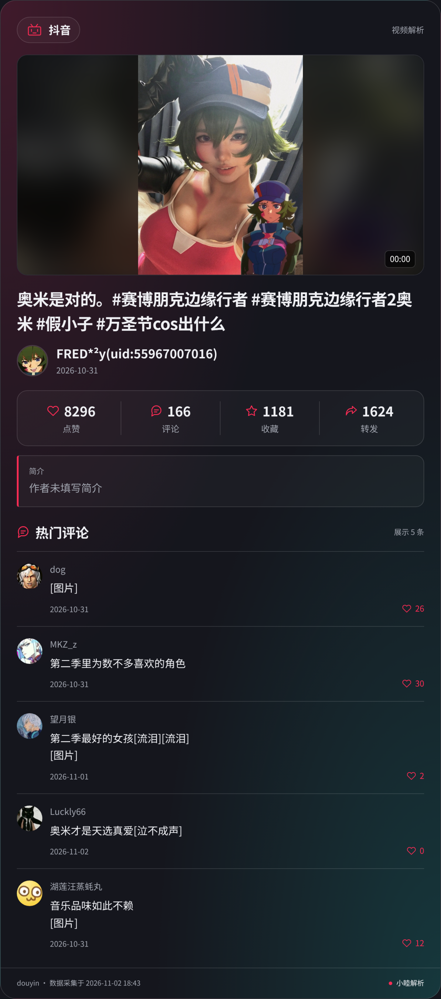
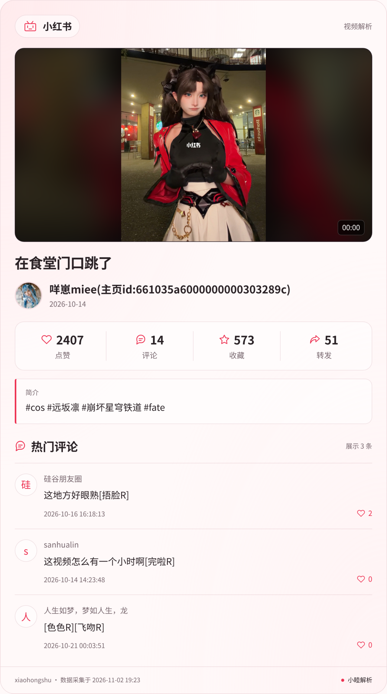

# 小睦解析 · Mortis Analysis

`nonebot-plugin-mortis-analysis`

适用于 NoneBot2 / OneBot v11 的视频与图文分享解析插件。发送分享链接即可获取作品信息、热门评论和可播放媒体。
仍在施工中

## 功能

- **信息长图**：封面、标题、作者、发布时间、点赞、评论、收藏、转发和简介集中展示，热门评论接在简介下方。
- **按平台配色**：抖音红青、哔哩哔哩蓝粉、小红书红白。
- **解析提示**：开始解析前引用分享消息，回复“小睦将为你解析～”；已关闭的解析或平台不发送提示。
- **顺序发送**：B站、抖音和小红书先发送信息长图；图集原图按顺序合并转发，视频单独发送，背景音乐单独发送。
- **热门评论**：支持头像、点赞、评论表情、评论图片及部分楼中楼。可按群或私聊关闭评论，也可切换文字转发模式。
- **平台凭据**：通过 NoneBot 环境配置填写 B站 SESSDATA、小红书 Cookie。
- **视频上限**：默认最多 8 分钟、80 MB。超限只发送作品信息和原链接，不自动压缩、分段或改发群文件。已知时长与文件大小尽早拦截；大小未知时流式下载到上限即停止并清理，时长缺失时使用本地媒体信息复核。
- **解析控制**：支持全局平台开关、群/私聊解析开关与评论控制。
- **失败降级**：长图渲染不可用时发送作品文字；评论不可用不阻止发送媒体；下载自动尝试同一媒体的备用地址，单个媒体不可用时继续发送其余内容并提示缺失数量；缺失的计数显示 `—`。

## 效果示例

先回复解析提示，再发送信息长图和原始媒体。点击图片可查看大图。

**群聊发送效果**



| 哔哩哔哩 | 抖音 | 小红书 |
| --- | --- | --- |
|  |  |  |

## 平台支持

| 平台 | 作品与媒体 | 信息长图与评论 | 访问方式 |
| --- | --- | --- | --- |
| 哔哩哔哩 | 视频、分P；另支持动态、直播信息、专栏、收藏夹 | 视频支持长图、热门评论 | 公开内容可匿名；部分功能需 SESSDATA |
| 抖音 | 视频、图集、背景音乐 | 平台主题长图、可用热评 | 匿名访问，无需填写登录 Cookie |
| 小红书 | 视频、图文笔记 | 平台主题长图、页面可用评论 | 匿名或配置 Cookie；完整分享链接需保留 xsec_token |
| 网易云音乐 | 音乐分享 | 音乐信息 | 部分解析依赖第三方公开接口 |

网站接口、地区、登录状态及平台风控会影响可用性；本插件不处理验证码或付费授权。

## 环境与安装

- Python 3.10 或以上、NoneBot2、OneBot v11 适配器。
- 系统安装 FFmpeg、Chromium、中文字体和 Node.js。
- 消息平台需支持 OneBot v11 的图片、视频与合并转发接口。

在已创建的 NoneBot 项目目录中，通过 NB-CLI 安装：

```sh
nb plugin install nonebot-plugin-mortis-analysis
```

也可以使用 pip：

```sh
pip install nonebot-plugin-mortis-analysis
```

使用 pip 安装时，将模块加入机器人项目 `pyproject.toml` 已有的插件列表：

```toml
[tool.nonebot]
plugins = ["nonebot_plugin_mortis_analysis"]
```


## 配置

在机器人项目的私有 `.env` 文件中按下表填写配置。配置也接受原有 `MORTIS_RESOLVER_` 前缀；同时填写时优先使用 `MORTIS_ANALYSIS_`。

| 环境变量 | 默认值 | 含义 |
| --- | --- | --- |
| `MORTIS_ANALYSIS_ENABLED` | `true` | 全局启用解析 |
| `MORTIS_ANALYSIS_PARSE_NOTICE` | `小睦将为你解析～` | 引用原消息的解析提示语；设为空字符串可关闭提示 |
| `MORTIS_ANALYSIS_NICKNAME` | `小睦解析` | 长图署名 |
| `MORTIS_ANALYSIS_HOT_COMMENT_COUNT` | `5` | 热评条数，0–10；0 表示不展示评论 |
| `MORTIS_ANALYSIS_VIDEO_MAX_DURATION` | `480` | 视频时长上限，单位秒；各平台统一使用 |
| `MORTIS_ANALYSIS_VIDEO_MAX_SIZE_MB` | `80` | 视频大小上限，单位 MB |
| `MORTIS_ANALYSIS_BILI_SESSDATA` | 空 | 只填 SESSDATA 值 |
| `MORTIS_ANALYSIS_XHS_CK` | 空 | 小红书完整 Cookie 请求头值 |
| `HTMLRENDER_BROWSER_EXECUTABLE_PATH` | htmlrender 默认值 | 系统 Chromium 路径 |

兼容配置项：`BILI_SESSDATA`、`XHS_CK`、`R_GLOBAL_NICKNAME` 分别作为对应带 `MORTIS_ANALYSIS_` 前缀配置的后备值。`GLOBAL_RESOLVE_CONTROLLER` 可用逗号分隔处理器名禁用平台，取值为 `bilibili,dy,xiaohongshu,netease`。

配置在插件加载时从 NoneBot 读取，修改 `.env` 后重启机器人生效。插件不要求配置登录凭据即可加载。

小红书 Cookie 仅注入官方 HTTPS 域名会话，不传给短链或媒体 CDN。

## 管理指令

群管理、群主或机器人主人可使用以下指令；在群内先 @机器人：

| 指令 | 作用 |
| --- | --- |
| `开启解析` / `关闭解析` | 控制当前群或私聊的解析 |
| `开启评论` / `关闭评论` | 控制当前群或私聊的评论 |
| `切换评论模式` | 切换长图评论和文字合并转发 |
| `查看关闭解析` | 主人查看停用列表 |
| `重载评论模板` | 主人重载文字模式配套的独立评论模板 |

信息长图模板为包内 `card.html`；自定义配色位于 `card.py`。

## 数据与部署

所有插件写入的文件由 `nonebot-plugin-localstore` 管理：配置目录存放自定义评论模板，数据目录存放解析/评论开关，缓存目录存放临时媒体。可使用 localstore 的 `LOCALSTORE_USE_CWD` 或 `LOCALSTORE_PLUGIN_DATA_DIR`、`LOCALSTORE_PLUGIN_CONFIG_DIR`、`LOCALSTORE_PLUGIN_CACHE_DIR` 配置持久化路径。容器部署需要持久化这些目录。

OneBot 协议端与机器人需能够读取同一份媒体文件。异机部署应在宿主中配置受限媒体传输；插件不会启动公开文件服务，也不依赖特定 Docker 布局。Cookie 源文件和缓存目录不得对外发布。

从源码开发或验证：

```sh
python -m pip install -e '.[dev]'
python -m unittest discover -s tests -v
python scripts/check_package.py
python -m build
python -m twine check --strict dist/*
```

## 许可证

本项目采用 [MulanPSL-2.0](https://github.com/Ryshcyn/nonebot-plugin-mortis-analysis/blob/main/LICENSE)。平台名称和图标仅用于标识内容来源。

